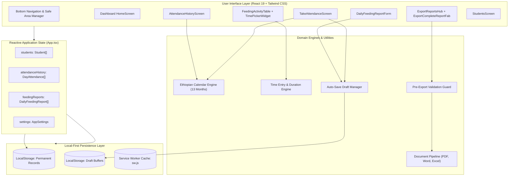
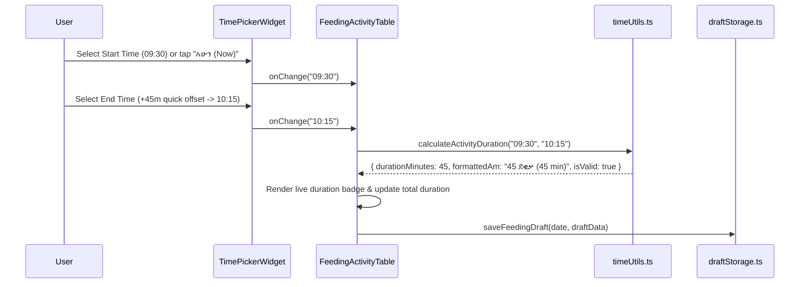

# RollCall – Architectural Overview & System Design

RollCall is built upon a **Local-First, Offline-Authoritative Architecture**. It executes entirely on the user's client device with zero external server dependencies for data persistence or report document generation.

---

## 🏛️ System Architecture Diagram

---

## 🔄 Unidirectional Data Flow

1. **User Interaction**:
   The user enters data via touch-friendly inputs (e.g., student attendance status toggles, Ethiopian date picker, time-picker presets, coordinator details).
2. **Immediate Local Draft Auto-Save**:
   Before official submission, input changes are debounced (450ms) and streamed into `draftStorage.ts`. This ensures no data is lost even if the browser crashes, the phone reboots, or the app is closed.
3. **Commit & Validation**:
   When the user submits the form ("Save Report" or "Save Attendance"):
   - Pure domain validators verify constraints (e.g. valid names, positive numbers, non-reversed time orders).
   - If valid, the committed object updates central state in `App.tsx` and writes to permanent storage.
   - The associated draft buffer for that date is safely cleared.
4. **Document Generation Pipeline**:
   When exporting reports:
   - `ReportValidationModal` checks for existing student records and populated sections.
   - Pure data models are converted in-memory into binary document streams:
     - PDF: vector rendering via `jspdf` and `jspdf-autotable`.
     - Word: OpenXML `.docx` generation via `docx`.
     - Excel: SpreadsheetML `.xlsx` generation via `xlsx`.
   - Browser downloads are triggered immediately without backend roundtrips.

---

## ⏱️ Activity Schedule & Duration Calculation Architecture

If the user mistakenly enters an end time earlier than start time (e.g., Start: `10:30`, End: `09:15`):
`calculateActivityDuration` detects the inverted order, flags `isValid: false`, and supplies the bilingual alert `የማብቂያ ሰዓት ከመጀመሪያ ሰዓት ቀድሟል (End time is earlier than start time)`. The row is highlighted in light red, alerting the user immediately.

---

## 🛡️ Standalone PWA Architecture

- **Manifest (`public/manifest.json`)**: Configured with `display: "standalone"`, `orientation: "any"`, custom app theme colors, and multi-size launcher icons.
- **Service Worker (`public/sw.js`)**: Implements cache-first strategy for static assets and offline navigation fallbacks, guaranteeing full application functionality when disconnected from the internet.
- **Hardware Safe-Area Compatibility**: Respects CSS environment variables (`env(safe-area-inset-bottom)`) so bottom action bars and floating export buttons never collide with Android system navigation bars or iPhone gesture indicators.
