# RollCall — Student Attendance & Feeding Management


[](https://tranquil-youtiao-db129b.netlify.app)
[](https://react.dev)
[](https://www.typescriptlang.org)
[](https://vitejs.dev)
[](https://tailwindcss.com)
[](https://web.dev/progressive-web-apps)
[](https://capacitorjs.com)
[](LICENSE)

> **A modern, offline-first Progressive Web App for teachers to manage classroom attendance and daily feeding programs — with bilingual support (English/Amharic), Ethiopian calendar integration, and comprehensive reporting.**

---

## ✨ Key Features

### 📊 **Attendance Management**
- **Quick Daily Roll-Call** — Mark Present / Absent / Permission / Late with one tap
- **Auto-Save Drafts** — Never lose progress; drafts persist across sessions
- **Audit Trail** — Every modification logs timestamp, author, and reason
- **Quick Notes** — Tag students with Sick, Excused, Late, Appointment
- **Ethiopian Calendar Support** — Native Ethiopian date display and navigation

### 🍽️ **Daily Feeding Program**
- **Complete Feeding Reports** — Coordinator, food type, location, participant counts
- **Activity Scheduler** — Lesson/Game/None with start/end times and duration calculation
- **Individual Student Tracking** — Check off students who received meals
- **Gaps & Challenges Log** — Document daily observations and issues
- **Grade/Section Filtering** — Organize feeding by class structure

### 📈 **Comprehensive Reporting**
| Report Type | Formats | Description |
|-------------|---------|-------------|
| **Daily** | PDF, Word, Excel | Attendance + Feeding combined or separate |
| **Weekly** | PDF, Word, Excel | Aggregated weekly summaries with trends |
| **Monthly** | PDF, Word, Excel | Month-over-month comparison charts |
| **Termly** | PDF, Word, Excel | Semester/term breakdowns with feeding stats |
| **Annual** | PDF, Word, Excel | Full academic year with term comparisons |
| **Individual Student** | PDF | Complete profile with attendance history |

### 🌐 **Internationalization & Accessibility**
- **Full English ↔ Amharic (አማርኛ) Support** — UI, reports, and exports
- **RTL-Ready Layout** — Proper Amharic text rendering with Noto Sans Ethiopic & Abyssinica SIL fonts
- **Light / Dark / System Theme** — Persisted preference with smooth transitions
- **Offline-First Architecture** — Service Worker + localStorage; works without internet

### 📱 **PWA & Mobile Experience**
- **Installable** — Add to home screen on Android, iOS, Windows, macOS
- **Standalone Mode** — Launches without browser chrome
- **Responsive Design** — Mobile-first, works beautifully on desktop
- **Safe-Area Insets** — Proper notch/Dynamic Island handling
- **Push-to-Install** — Native browser install prompts

### ⚙️ **Data Management**
- **JSON Backup/Restore** — Full data export/import with versioning
- **Excel Import** — Bulk student roster import (.xlsx/.csv)
- **Sample Data Loader** — One-click demo class with attendance & feeding records
- **Student Archiving** — Soft-delete with preserved history
- **School Terms & Holidays** — Configure academic calendar

---

## 🖼️ Screenshots

### Dashboard (Home)
| Light Mode | Dark Mode | Ethiopian Calendar |
|:---:|:---:|:---:|
| 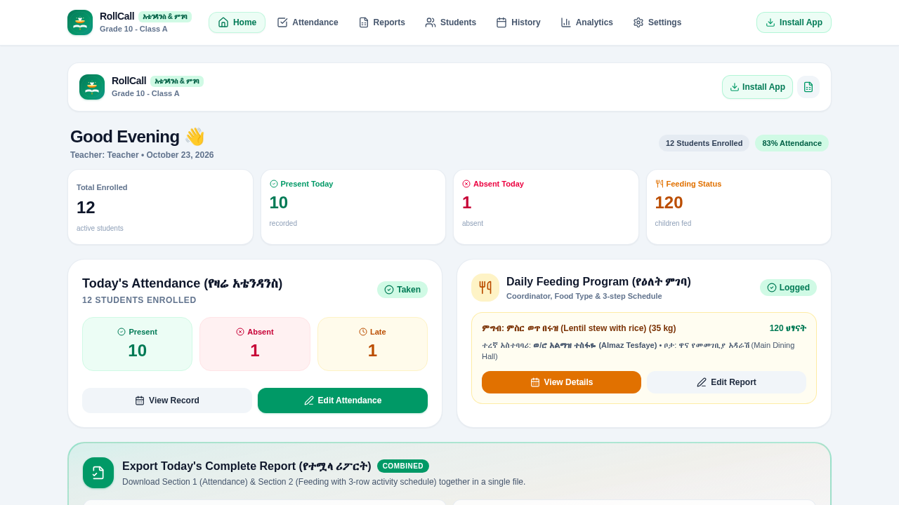 | 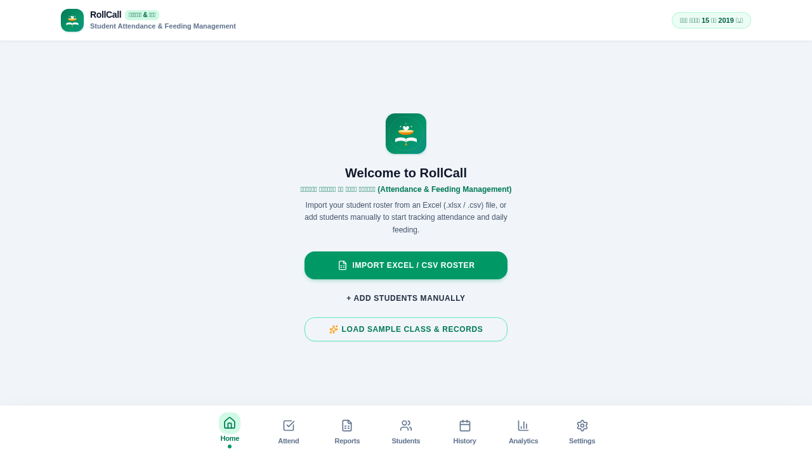 | 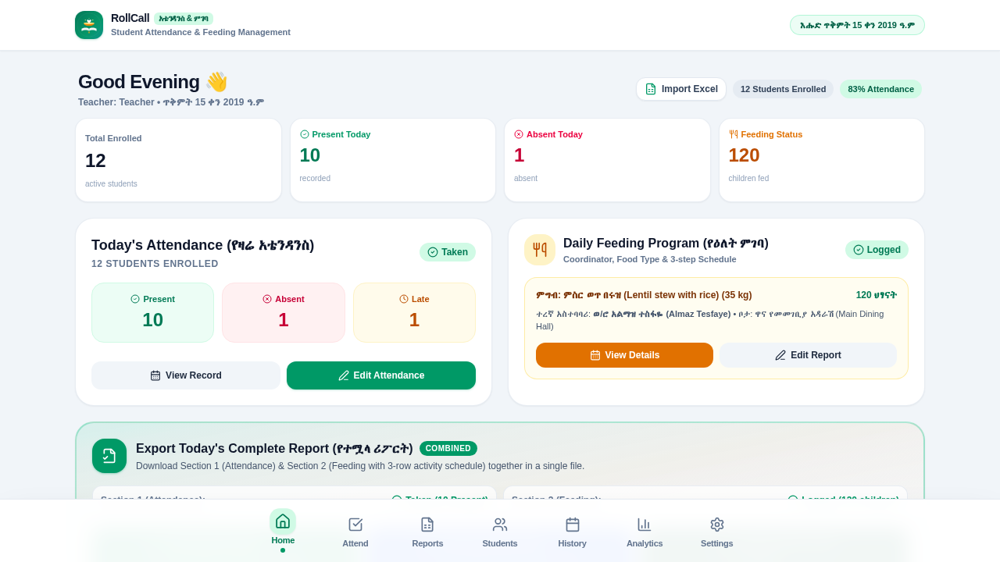 |

### Attendance & Students
| Take Attendance | Student Roster | Student Details |
|:---:|:---:|:---:|
| 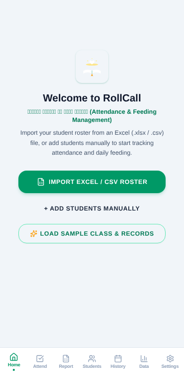 | 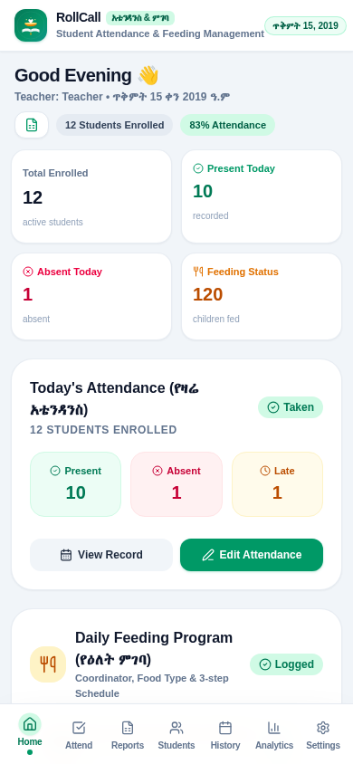 | 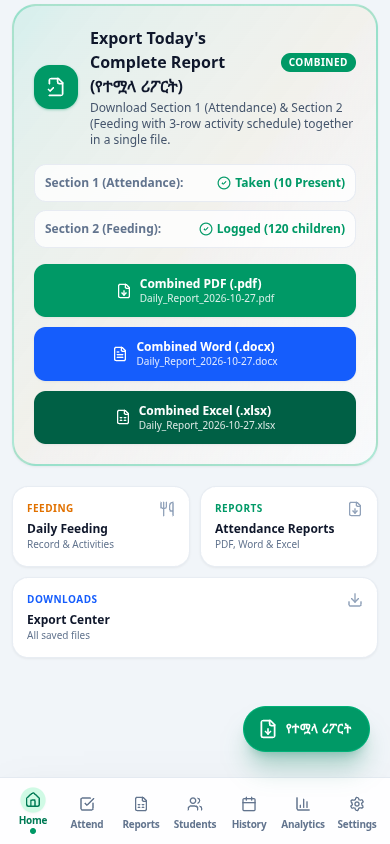 |

### Reports & Feeding
| Reports Hub | Feeding Report | Report History |
|:---:|:---:|:---:|
| 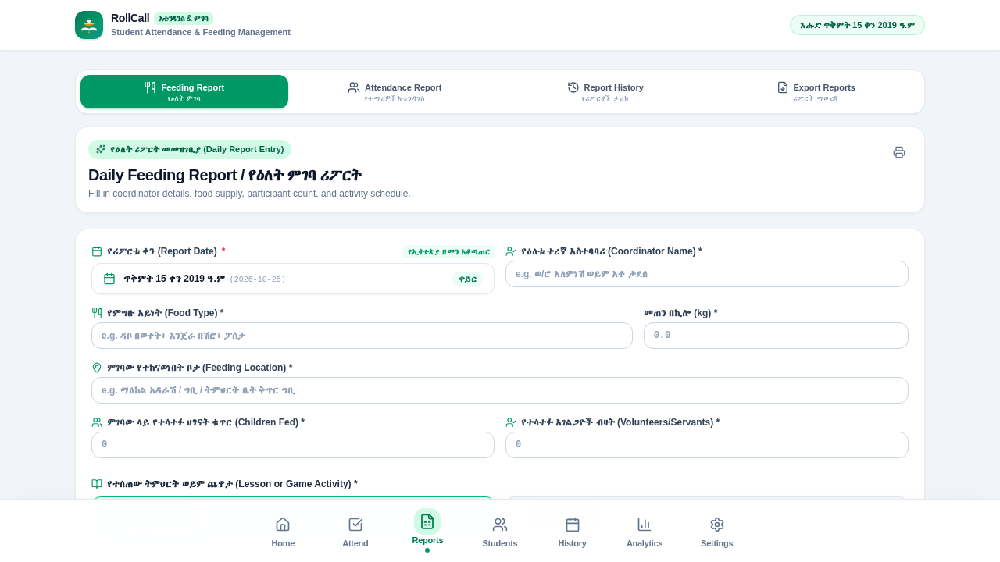 | 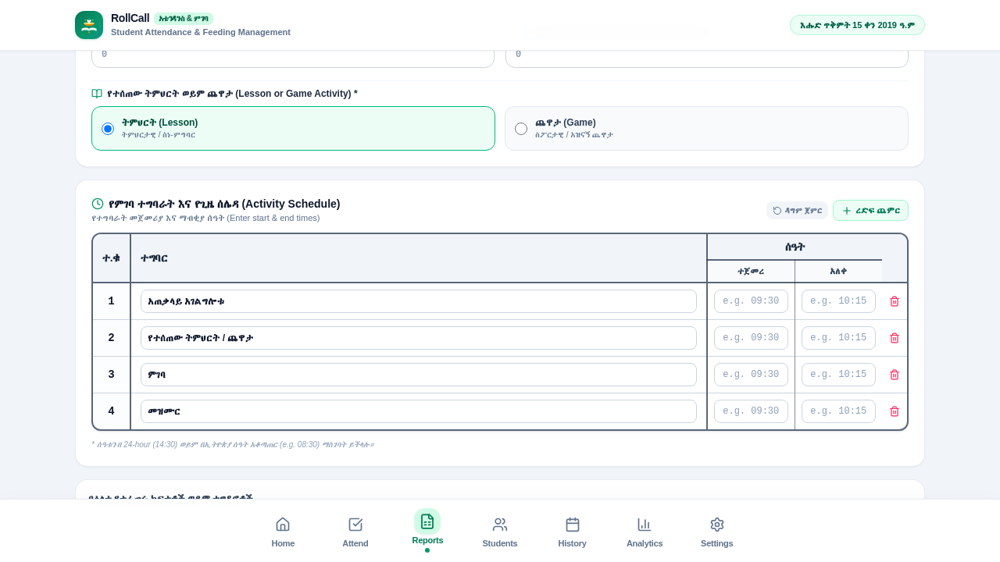 | 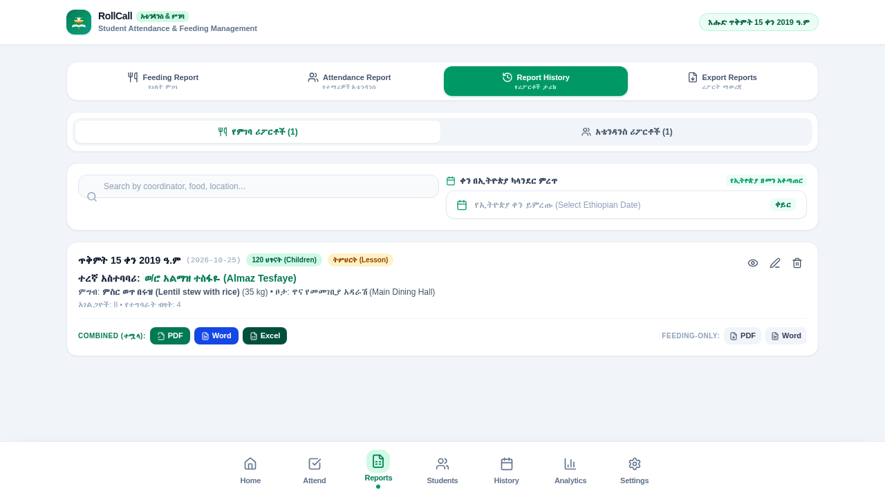 |

### Desktop Experience
| Desktop Dashboard | Desktop Reports | Export Center |
|:---:|:---:|:---:|
| 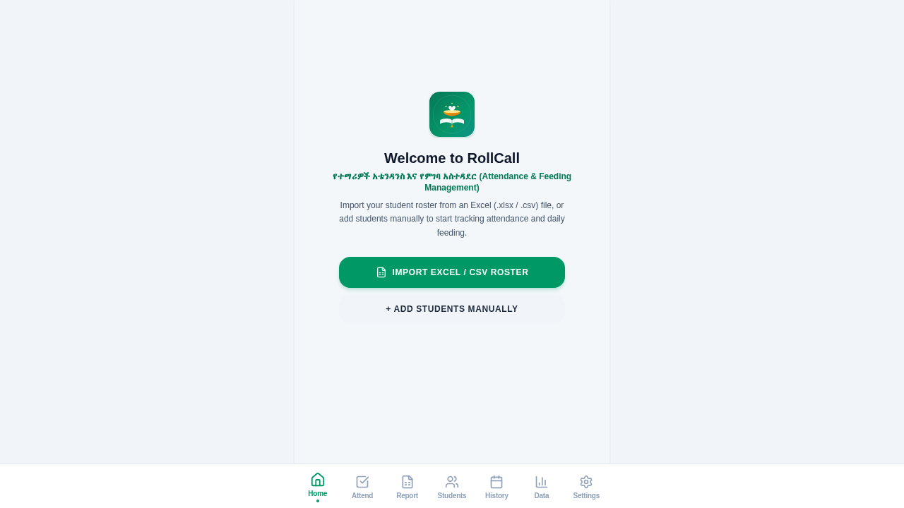 | 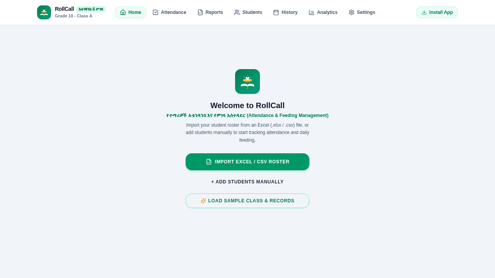 | 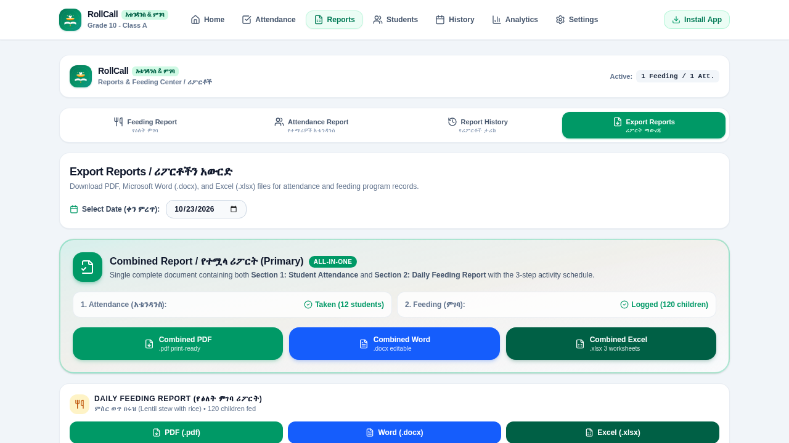 |

---

## 🛠️ Tech Stack

| Category | Technologies |
|----------|--------------|
| **Frontend** | React 19, TypeScript, Vite 8 |
| **Styling** | Tailwind CSS 4, CSS Variables, Custom Fonts |
| **State** | React Hooks (useState, useEffect, useCallback), localStorage |
| **Charts** | Recharts 3 (attendance trends, monthly comparisons) |
| **Export** | jsPDF + jsPDF-AutoTable (PDF), docx (Word), xlsx (Excel) |
| **PWA** | Vite PWA Plugin, Workbox, Service Worker |
| **Mobile** | Capacitor 8 (Android/iOS builds) |
| **i18n** | Custom Context-based solution (English/Amharic) |
| **Calendar** | Custom Ethiopian Calendar implementation |
| **Date/Time** | Native Intl API, custom formatting utilities |
| **Icons** | Lucide React |
| **Animation** | Motion (Framer Motion successor) |
| **Testing** | tsx native test runner |

---

## 🚀 Getting Started

### Prerequisites
- **Node.js** 18+ and **npm** 9+
- **Git** for version control

### Installation

```bash
# Clone the repository
git clone https://github.com/your-username/student-attendance-app.git
cd student-attendance-app

# Install dependencies
npm install

# Start development server
npm run dev
```

The app will be available at `http://localhost:3000`

### Build for Production

```bash
# Create optimized production build
npm run build

# Preview production build locally
npm run preview
```

### Run Tests

```bash
# Run all unit tests
npm test

# Type-check only
npm run lint
```

### Mobile Builds (Capacitor)

```bash
# Add Android platform (first time only)
npx cap add android

# Sync web assets to native project
npx cap sync

# Open in Android Studio
npx cap open android
```

---

## 📁 Project Structure

```
student-atttendance/
├── public/
│   ├── fonts/                 # Noto Sans Ethiopic, Abyssinica SIL
│   ├── icons/                 # PWA icons (192, 512, maskable)
│   ├── manifest.json          # PWA manifest
│   ├── sw.js                  # Service Worker
│   └── assets/                # Static images
├── src/
│   ├── components/            # React components
│   │   ├── HomeScreen.tsx
│   │   ├── TakeAttendanceScreen.tsx
│   │   ├── StudentsScreen.tsx
│   │   ├── ReportsScreen.tsx
│   │   ├── HistoryScreen.tsx
│   │   ├── SettingsScreen.tsx
│   │   ├── DataScreen.tsx
│   │   ├── FeedingActivityTable.tsx
│   │   ├── ExportReportsHub.tsx
│   │   ├── ExportCompleteReportFab.tsx
│   │   ├── ExcelImportModal.tsx
│   │   ├── DailyFeedingReportForm.tsx
│   │   ├── StudentDetailModal.tsx
│   │   ├── StudentAttendanceReportView.tsx
│   │   ├── ReportValidationModal.tsx
│   │   ├── ReportStorageSettings.tsx
│   │   ├── ReportHistory.tsx
│   │   ├── PrintReportModal.tsx
│   │   ├── ManualTimeEntryModal.tsx
│   │   ├── EthiopianDatePicker.tsx
│   │   ├── TimePickerWidget.tsx
│   │   ├── FloatingBottomNav.tsx
│   │   ├── AppLogo.tsx
│   │   ├── Toast.tsx
│   │   ├── ConfirmModal.tsx
│   │   └── ErrorBoundary.tsx
│   ├── i18n/
│   │   ├── translations.ts    # English + Amharic translations
│   │   └── LanguageContext.tsx
│   ├── utils/
│   │   ├── storage.ts         # localStorage persistence layer
│   │   ├── attendance.ts      # Attendance calculations & helpers
│   │   ├── ethiopianCalendar.ts # Ethiopian date conversion
│   │   ├── feeding.ts         # Feeding report logic
│   │   ├── exports.ts         # PDF/Word/Excel export utilities
│   │   ├── reportAggregations.ts # Weekly/Monthly/Termly/Annual reports
│   │   ├── termlyAnnualExports.ts # Term/Annual export formatting
│   │   ├── studentExports.ts  # Individual student reports
│   │   ├── combinedExports.ts # Combined attendance+feeding
│   │   ├── timeUtils.ts       # Time formatting helpers
│   │   ├── draftStorage.ts    # Draft persistence
│   │   ├── sampleData.ts      # Demo data generator
│   │   └── pdfFont.ts         # Amharic font registration for PDF
│   ├── types.ts               # TypeScript interfaces & types
│   ├── App.tsx                # Root component, routing, state
│   ├── main.tsx               # Entry point
│   └── index.css              # Global styles, Tailwind imports
├── index.html                 # HTML template, PWA meta tags
├── package.json
├── tsconfig.json
├── vite.config.ts
└── README.md
```

---

## 🌍 Live Application

**🔗 [https://tranquil-youtiao-db129b.netlify.app](https://tranquil-youtiao-db129b.netlify.app)**

The app is deployed as a Progressive Web App on Netlify with automatic HTTPS, CDN distribution, and instant cache invalidation on deploy.

---

## 📦 Deployment

### Netlify (Recommended)
1. Connect your GitHub repository to Netlify
2. Build command: `npm run build`
3. Publish directory: `dist`
4. Netlify auto-detects `vite.config.ts` and configures headers for PWA

### Vercel
```bash
npm i -g vercel
vercel --prod
```

### Static Hosting (Any)
Upload the `dist/` folder to any static host (GitHub Pages, Firebase Hosting, AWS S3 + CloudFront, etc.)

---

## 🤝 Contributing

Contributions are welcome! Please read our contributing guidelines before submitting PRs.

1. Fork the repository
2. Create a feature branch (`git checkout -b feature/amazing-feature`)
3. Commit your changes (`git commit -m 'Add amazing feature'`)
4. Push to the branch (`git push origin feature/amazing-feature`)
5. Open a Pull Request

---

## 📄 License

This project is licensed under the **MIT License** — see the [LICENSE](LICENSE) file for details.

---

## 👨‍💻 Developer

**Natnael Sema** — Full-Stack Developer

- **Portfolio:** [https://natnaelsema.netlify.app](https://natnaelsema.netlify.app)
- **GitHub:** [@natiman34](https://github.com/natiman34)
- **LinkedIn:** [linkedin.com/in/natnaelsema](https://www.linkedin.com/in/natnaelsema/)
- **Email:** natim0570@gmail.com

---

## 🙏 Acknowledgments

- **Ethiopian Calendar Algorithm** — Adapted from public domain implementations
- **Noto Sans Ethiopic & Abyssinica SIL Fonts** — Google Fonts & SIL International
- **Lucide Icons** — Beautiful open-source icon set
- **Tailwind CSS** — Utility-first CSS framework
- **Vite & React Teams** — Exceptional developer experience

---

<div align="center">

**Built with ❤️ for educators everywhere**

*RollCall — Making attendance simple, feeding programs organized, and reporting effortless.*

</div>